<a href="https://serenaesteve.com">
<picture>
  <source media="(prefers-color-scheme: dark)" srcset="./assets/hero-dark.svg">
  
</picture>
</a>

<picture>
  <source media="(prefers-color-scheme: dark)" srcset="./assets/marquee-dark.svg">
  
</picture>

<br>

<picture>
  <source media="(prefers-color-scheme: dark)" srcset="./assets/title-sobre-dark.svg">
  
</picture>

<table>
<tr>
<td width="60%" valign="middle">

Desarrolladora **Full Stack** en formación, cursando el **Grado Superior en DAM** en TAME Formación. Mi trayectoria combina experiencia administrativa real con una creciente especialización en tecnología, y eso se nota en lo que construyo: herramientas que resuelven problemas de oficina de verdad.

Me apasiona crear soluciones digitales que unan **funcionalidad con diseño**. Resolutiva, organizada y con espíritu emprendedor.

`Emprendedora` `Comunicación` `Trabajo en equipo` `Resolutiva` `Marketing digital` `IA aplicada`

📍 Mislata, Valencia &nbsp;·&nbsp; ✉ [serenaestevee@gmail.com](mailto:serenaestevee@gmail.com)

</td>
<td width="40%" align="center" valign="middle">

<picture>
  <source media="(prefers-color-scheme: dark)" srcset="./assets/photo-dark.svg">
  
</picture>

</td>
</tr>
</table>

<br>

<picture>
  <source media="(prefers-color-scheme: dark)" srcset="./assets/title-stack-dark.svg">
  
</picture>

```python
# stack.py · lo que uso para construir cosas ✨

serena = {
    "frontend":  ["HTML5 / CSS3", "JavaScript", "Tailwind CSS", "Pug"],
    "backend":   ["Python", "PHP", "C", "C++", "Flask"],
    "data":      ["SQL / SQLite", "MongoDB"],
    "ai":        ["Ollama", "Web Scraping"],
    "marketing": ["SEO / SEM"],
}

print(sum(map(len, serena.values())), "tecnologías y aprendiendo más 🚀")
```


<br>

<picture>
  <source media="(prefers-color-scheme: dark)" srcset="./assets/title-proyectos-dark.svg">
  
</picture>

**73 proyectos en total.** Estos son los que mejor me representan:

| № | Proyecto | Qué es | Stack |
|:--:|---|---|---|
| **63** | [**Portify**](https://portify.es/) ↗ | Plataforma para crear portfolios profesionales con IA, rápido y sin complicaciones. En producción. | `Python` `Flask` `IA` |
| **70** | [**SGT — Super GT**](https://sgt.serenaesteve.com) ↗ | Juego de coches deportivos en 3D hecho desde cero. Pruébalo en el navegador. | `Three.js` `JavaScript` `3D` |
| **60** | [**RAG Serena**](https://github.com/serenaesteve/Rag-Serena-) | Mi propio sistema RAG con IA local: le preguntas a tus documentos y responden. | `Python` `IA` `RAG` |
| **73** | [**ERP-CRM**](https://github.com/serenaesteve/Sistema-de-gesti-n-empresarial) | Mini ERP-CRM: clientes, pedidos, facturas rectificativas, compras, stock, roles y backups. | `PHP` `JS` `SQLite` `MySQL` |
| **69** | [**TableTop Tracker**](https://github.com/serenaesteve/tabletop) | Partidas de juegos de mesa con ranking Elo multijugador, recomendador y asistente IA. | `Flask` `IA` `SQLite` |
| **51** | [**Noir Detective**](https://github.com/serenaesteve/Noir-Detective-) | Aventura noir interactiva donde tus decisiones (y la IA) mueven la historia. | `Python` `IA` `Juego` |
| **67** | [**Labora TAME**](https://github.com/serenaesteve/LABORA-Tame-) | Gestión de prácticas y formación integrada con Labora. Se usa a diario en TAME Formación. | `Python` `Flask` `SQL` |
| **61** | [**Carta Digital con IA**](https://github.com/serenaesteve/Carta-digital-con-IA-para-restaurantes) | Carta interactiva para restaurantes que recomienda platos según el cliente. | `Python` `IA` `Flask` |
| **01** | [**Thais Esteve · Fotografía**](https://serenaesteve.github.io/thais/) ↗ | Web para una fotógrafa profesional de familia y naturaleza: galerías, redes y contacto. | `HTML` `CSS` `JS` |

<details>
<summary><b>✦ Ver los 73 proyectos</b></summary>
<br>

**🤖 IA aplicada & automatización**

[08 · Descargar imágenes con IA](https://github.com/serenaesteve/descargar-im-genes-con-IA) ·
[09 · Ollama Currículum](https://github.com/serenaesteve/ollamacurriculum) ·
[11 · IA para Dietética](https://github.com/serenaesteve/iaparadietetica) ·
[12 · IA Inicial](https://github.com/serenaesteve/iainicial) ·
[27 · Automatización de correos](https://github.com/serenaesteve/Sistema-de-automatizaci-n-de-gesti-n-de-correos-electr-nicos) ·
[29 · Clasificación documental](https://github.com/serenaesteve/Plataforma-de-clasificaci-n-documental-inteligente) ·
[31 · Asistente virtual interno](https://github.com/serenaesteve/Asistente-virtual-interno-para-empleados-que-permita-consultar-procedimientos) ·
[32 · Chatbot de atención al cliente](https://github.com/serenaesteve/Chatbot-de-atenci-n-al-cliente-integrado-en-la-p-gina-web) ·
[33 · Respuesta automática a consultas](https://github.com/serenaesteve/Sistema-de-respuesta-autom-tica-a-consultas-frecuentes-de-clientes) ·
[34 · Análisis de ventas](https://github.com/serenaesteve/Plataforma-de-an-lisis-de-ventas-que-genera-informes-autom-ticos-y-detecte-tendencias-comerciales.) ·
[35 · Panel de KPIs](https://github.com/serenaesteve/Panel-de-control-empresarial-con-indicadores-clave-de-rendimiento-generados-autom-ticamente-) ·
[36 · Predicción de demanda](https://github.com/serenaesteve/-Sistema-predictivo-b-sico-para-estimaci-n-de-demanda-o-previsi-n-de-ventas-futuras.) ·
[37 · Segmentación de clientes](https://github.com/serenaesteve/Herramienta-de-segmentaci-n-autom-tica-de-clientes-seg-n-comportamiento-de-compra) ·
[39 · Oportunidades comerciales](https://github.com/serenaesteve/Sistema-inteligente-de-seguimiento-de-oportunidades-comerciales-y-generaci-n-de-alertas-de-negocio.) ·
[40 · Asistente WhatsApp](https://github.com/serenaesteve/Asistente-whatsapp) ·
[41 · Procesos administrativos](https://github.com/serenaesteve/Automatizaci-n-de-procesos-administrativos-repetitivos-mediante-flujos-de-trabajo-digitales.) ·
[43 · Informes empresariales](https://github.com/serenaesteve/Asistente-para-generaci-n-autom-tica-de-informes-empresariales-peri-dicos.) ·
[44 · Apoyo a decisiones](https://github.com/serenaesteve/Herramienta-de-apoyo-a-la-toma-de-decisiones-basada-en-an-lisis-autom-tico-de-datos-hist-ricos.) ·
[45 · Satisfacción del cliente](https://github.com/serenaesteve/Sistema-de-an-lisis-de-satisfacci-n-del-cliente-mediante-procesamiento-de-opiniones-) ·
[46 · Copiloto empresarial](https://github.com/serenaesteve/Copiloto-empresarial-entrenado-con-la-documentaci-n-interna-de-la-empresa.) ·
[47 · Automatización RRHH](https://github.com/serenaesteve/Sistema-de-automatizaci-n-de-tareas-de-recursos-humanos-como-gesti-n-de-solicitudes-de-curr-culos.) ·
[49 · Contenidos corporativos](https://github.com/serenaesteve/Herramienta-de-generaci-n-autom-tica-de-contenidos-comerciales-o-comunicaciones-corporativas.) ·
[50 · Gestión comercial](https://github.com/serenaesteve/Sistema-de-apoyo-a-la-gesti-n-comercial-que-sugiera-acciones-de-seguimiento-con-clientes.) ·
[55 · Implantación progresiva de IA](https://github.com/serenaesteve/-Sistema-de-implantaci-n-progresiva-de-IA-adaptado-al-crecimiento-de-la-empresa.) ·
[56 · Agendas y tareas](https://github.com/serenaesteve/Herramienta-de-organizaci-n-autom-tica-de-agendas-y-tareas-empresariales.) ·
[57 · Atención postventa](https://github.com/serenaesteve/Sistema-de-automatizaci-n-de-procesos-de-atenci-n-postventa.) ·
[58 · Mantenimiento de IA](https://github.com/serenaesteve/Servicio-de-mantenimiento-y-mejora-continua-de-soluciones-de-inteligencia-artificial-implantadas.) ·
[60 · RAG Serena](https://github.com/serenaesteve/Rag-Serena-) ·
[61 · Carta digital con IA](https://github.com/serenaesteve/Carta-digital-con-IA-para-restaurantes) ·
[62 · Gestión de candidatos](https://github.com/serenaesteve/Plataforma-de-gesti-n-de-candidatos-con-IA) ·
[63 · Portify](https://portify.es/) ·
[64 · Jefry](https://github.com/serenaesteve/Jefry)

**🏢 Gestión empresarial, datos & herramientas**

[04 · CRM Serena](https://github.com/serenaesteve/crmserena) ·
[05 · Correo IMAP](https://github.com/serenaesteve/correoimap) ·
[07 · Descargar imágenes](https://github.com/serenaesteve/descargar-im-genes-de-internet) ·
[26 · Web Scraper](https://github.com/serenaesteve/scrapearweb) ·
[30 · Extracción automática de datos](https://github.com/serenaesteve/Herramienta-de-extracci-n-autom-tica-de-datos-) ·
[38 · iLove PDF](https://github.com/serenaesteve/ilove-pdf) ·
[42 · Digitalización de documentos](https://github.com/serenaesteve/Plataforma-de-digitalizaci-n-y-organizaci-n-centralizada-de-documentos-empresariales.) ·
[48 · Control de productividad](https://github.com/serenaesteve/Plataforma-de-control-y-an-lisis-de-productividad-interna.) ·
[52 · Digitalización para pymes](https://github.com/serenaesteve/Plataforma-de-digitalizaci-n-accesible-para-peque-as-empresas-con-implantaci-n-r-pida-y-bajo-coste.) ·
[53 · Auditoría tecnológica](https://github.com/serenaesteve/-Servicio-de-auditor-a-tecnol-gica-y-diagn-stico-de-madurez-digital-empresarial.) ·
[54 · Integración de datos](https://github.com/serenaesteve/Plataforma-de-integraci-n-de-datos-procedentes-de-distintos-programas-empresariales-existentes.) ·
[59 · SPower](https://github.com/serenaesteve/spower) ·
[68 · SaaS Competencia](https://github.com/serenaesteve/saas-competencia) ·
[71 · Gestión de ficheros](https://github.com/serenaesteve/Gesti-n-de-informaci-n-almacenada-en-ficheros) ·
[73 · ERP-CRM](https://github.com/serenaesteve/Sistema-de-gesti-n-empresarial)

**🏫 TAME Formación · Labora**

[65 · Fichaje Labora TAME](https://github.com/serenaesteve/fichaje-labora-TAME-) ·
[66 · SAO Labora](https://github.com/serenaesteve/SAO-LABORA) ·
[67 · Labora TAME](https://github.com/serenaesteve/LABORA-Tame-)

**🌐 Webs, tiendas & diseño**

[01 · Thais Esteve · Fotografía](https://serenaesteve.github.io/thais/) ·
[02 · Netflix Thais](https://github.com/serenaesteve/netflixthais) ·
[03 · Web Portafolios](https://github.com/serenaesteve/Web-portafolios) ·
[06 · Correo Thais](https://github.com/serenaesteve/correothais) ·
[10 · Web Adopciones](https://github.com/serenaesteve/webadopciones) ·
[13 · Logos](https://github.com/serenaesteve/logos) ·
[14 · Pug](https://github.com/serenaesteve/pug) ·
[15 · Tailwind CSS](https://github.com/serenaesteve/Tailwind) ·
[16 · Web con panel de control](https://github.com/serenaesteve/webconpanelcontrol) ·
[17 · Entrenaria](https://github.com/serenaesteve/entrenaria) ·
[18 · Pet Shop](https://github.com/serenaesteve/petshop) ·
[19 · Panel Pet Shop](https://github.com/serenaesteve/paneldecontrolpetshop) ·
[20 · Tienda de juguetes](https://github.com/serenaesteve/paneladministraciontiendajuguetes) ·
[21 · Tienda de juguetes mejorada](https://github.com/serenaesteve/tiendajuguetesmejorada) ·
[22 · Blog Conia](https://github.com/serenaesteve/articulosblogconia) ·
[23 · Landing curso IA](https://github.com/serenaesteve/webcursoiamejorada) ·
[24 · Panel Getypost Thais](https://github.com/serenaesteve/getypost-panelthais) ·
[25 · Posicionamiento SEO](https://github.com/serenaesteve/posicionamientoseo) ·
[28 · Presupuestos y facturas](https://serenaesteve.github.io/Generador-autom-tico-de-presupuestos-y-facturas/) ·
[72 · Serena IU](https://github.com/serenaesteve/serena-iu)

**🎮 Juegos & 3D**

[51 · Noir Detective](https://github.com/serenaesteve/Noir-Detective-) ·
[69 · TableTop Tracker](https://github.com/serenaesteve/tabletop) ·
[70 · SGT — Super GT](https://sgt.serenaesteve.com)

</details>

<br>

<picture>
  <source media="(prefers-color-scheme: dark)" srcset="./assets/title-experiencia-dark.svg">
  
</picture>

### Programadora
**Atinem 2.0** · 13/05/2026 — 16/06/2026 · *Prácticas*

- 100 horas de prácticas de programación
- Desarrollo de 3 programas de gestión para la automatización de procesos administrativos

### Administrativa
**Mislata Formación SL** · 2022 — Actualidad

- Atención telefónica y presencial
- Gestión documental e informes
- Marketing y redes sociales
- Plan de igualdad empresarial

### Administrativa
**NEMASA · Ayuntamiento** · 3 meses · *Plan Social*

- Control de fichajes
- Documentación e informes

### Administrativa
**FOREDU** · 3 meses · *Prácticas*

- Gestión documental
- Redacción de comunicaciones
- Búsqueda de información

<br>

<picture>
  <source media="(prefers-color-scheme: dark)" srcset="./assets/title-educacion-dark.svg">
  
</picture>

| | Formación | Centro | Cuándo |
|:--:|---|---|---|
| 🎓 | **Desarrollo de Aplicaciones Multiplataforma** (Grado Superior) | TAME Formación | *Cursando actualmente* |
| 📋 | Técnico Auxiliar Administrativo | Colegio Santa Cruz de Mislata | 2019 — 2021 |
| 📚 | Educación Secundaria | Colegio Santa Cruz de Mislata | 2015 — 2019 |

**Idiomas**

```text
Español     ██████████  Nativo
Valenciano  ████████░░  Alto
Inglés      ███░░░░░░░  A2 · en progreso ↗
```

**Formación complementaria** &nbsp;✦&nbsp; IA aplicada a la empresa ✦ Planes de igualdad ✦ CRM ✦ Gestión SEM ✦ Social Media (nivel 1 y 2) ✦ Mecanografía avanzada ✦ Contasol & Factusol ✦ Office avanzado

<br>

<a href="mailto:serenaestevee@gmail.com">
<picture>
  <source media="(prefers-color-scheme: dark)" srcset="./assets/talk-dark.svg">
  
</picture>
</a>

<p align="center">
  <a href="mailto:serenaestevee@gmail.com"><b>Email</b></a>
  &nbsp;✦&nbsp;
  <a href="https://serenaesteve.com"><b>serenaesteve.com</b></a>
  &nbsp;✦&nbsp;
  <a href="https://www.linkedin.com/in/serena-sania-esteve-00a1aa375/"><b>LinkedIn</b></a>
  &nbsp;✦&nbsp;
  <a href="https://serenaesteve.com/serenagpt/"><b>SerenaGPT</b></a>
</p>

<p align="center">
  <sub>© 2026 · Serena Sania Esteve · Full Stack Developer · Valencia</sub>
</p>

<!-- ¿Curioseando el código? Pregúntale a SerenaGPT por mí: https://serenaesteve.com/serenagpt/ ✦ -->
